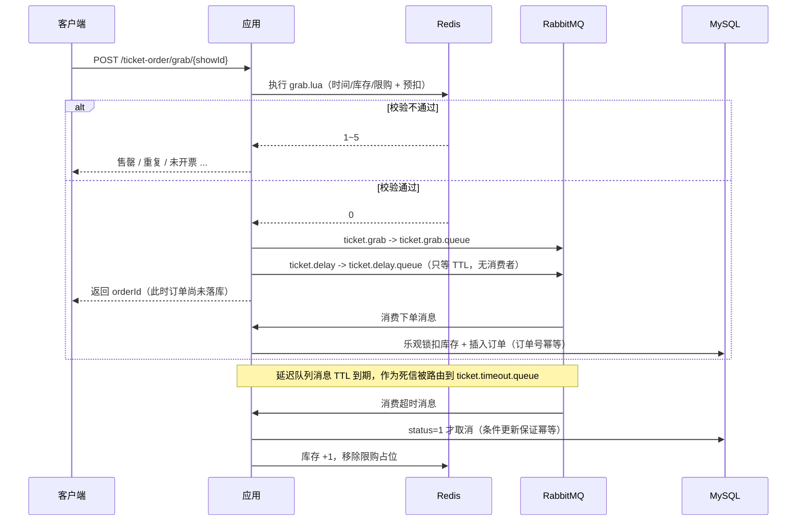

# ShowTicket · 演出抢票平台

一个面向演出票务场景的高并发电商后端：场馆/演出浏览、实名抢票、下单支付、超时自动关单、观演剧评与社交关注。

核心难点集中在**抢票链路**：用 Redis + Lua 做原子预扣与限购，用 RabbitMQ 做异步下单削峰，用「TTL + 死信队列」做超时关单与库存回补。

---

## 技术栈

| 层次 | 技术 |
| --- | --- |
| 语言 / 框架 | Java 21、Spring Boot 2.7、Spring MVC |
| 持久层 | MySQL 8.0、MyBatis-Plus |
| 缓存 | Redis 7（String / Hash / Set / ZSet / GEO / BitMap / HyperLogLog / Lua） |
| 消息队列 | RabbitMQ 3.13（异步下单、TTL+死信延迟关单、消费重试、死信队列、vhost 隔离） |
| 分布式协调 | Redisson（可重入锁） |
| 接口文档 | Knife4j 4.0（OpenAPI 3） |
| 前端 | Vue 3 + Vite + Vue Router + Axios，nginx 托管并反向代理 `/api` |
| 其他 | Hutool、Lombok、Docker Compose |

---

## 核心功能

- **登录**：手机号验证码 + Redis Token，双拦截器实现无感续期
- **登录风控**：验证码发送限流（同手机号 60 秒一次、同 IP 每小时 10 次，Lua 原子执行）；连续输错 5 次锁定 15 分钟
- **场馆**：详情缓存（逻辑过期防击穿 + 空值缓存防穿透）、附近场馆 GEO、详情页 UV 统计
- **演出**：按场馆查询在售演出与票档库存
- **抢票**：Lua 原子校验「开售时间 + 库存 + 一人一票」，RabbitMQ 异步落库
- **订单**：支付、订单详情、我的订单、超时未支付自动取消并回补库存
- **剧评**：发布剧评、点赞（ZSet 按时间排序）、点赞用户列表
- **社交**：关注 / 取关、共同关注（Set 交集）、关注流 Feed（推模式 + 滚动分页）
- **签到**：BitMap 按月存签到状态，位运算统计连续签到天数

---

## 技术文档

按技术点拆分的方案文档，包含场景、选型对比（为什么不用 X）、踩坑记录和面试追问：

- [docs/README.md](docs/README.md) — 文档索引
- [01 抢票链路：Redis + Lua](docs/01-抢票链路-Redis与Lua.md)
- [02 消息队列：RabbitMQ](docs/02-消息队列-RabbitMQ.md)
- [03 缓存设计：Redis](docs/03-缓存设计-Redis.md)
- [04 登录鉴权与风控](docs/04-登录鉴权与风控.md)
- [05 订单号与幂等](docs/05-订单号与幂等.md)
- [06 前端与 nginx 部署](docs/06-前端与nginx部署.md)
- [面试问答手册](docs/面试问答.md)

---

## 怎么运行

### 中间件清单（本机实际部署）

| 组件 | 地址 | 账号 | 说明 |
| --- | --- | --- | --- |
| MySQL | 127.0.0.1:3306 | root / 123456 | 库名 `show_ticket`，已导入 `sql/show_ticket.sql` |
| Redis | 192.168.100.130:6379 | 密码 123 | 虚拟机 |
| RabbitMQ | 192.168.100.130:5672 | admin / 123 | 虚拟机 Docker，vhost `show-ticket`，管理台 http://192.168.100.130:15672 |

换环境时改 `src/main/resources/application.yaml` 里对应的三段配置即可。

### 启动步骤

1. **数据库**：首次运行先导入 `sql/show_ticket.sql`（含建库、建表、种子数据：6 用户 / 5 分类 / 12 场馆 / 10 演出 / 6 条剧评）。
2. **RabbitMQ**：确认 vhost 已创建并给账号授权：
   ```bash
   rabbitmqctl add_vhost show-ticket
   rabbitmqctl set_permissions -p show-ticket admin ".*" ".*" ".*"
   ```
   交换机和队列**不用手动建**，应用启动时自动声明。
3. **启动后端**：IDEA 里打开 `backend/` 目录，跑 `ShowTicketApplication`；或命令行：
   ```bash
   cd backend && mvn spring-boot:run
   ```
4. 启动成功标志（控制台）：
   ```
   [预热] 场馆 GEO 写入完成，共 5 个分类
   [预热] 完成：场馆 12 个，票档 10 个
   ```

### 启动前端

方式一：开发模式（改动即时热更新，Vite 自带 /api 代理）

```bash
cd frontend
npm install          # 首次
npm run dev          # http://localhost:5173
```

方式二：nginx 托管（更接近部署形态，模拟生产）

```bash
cd frontend
npm install && npm run build
# 双击 frontend/nginx/start.bat 启动（用桌面的 nginx，8080 端口）
# 停止：双击 frontend/nginx/stop.bat
```

nginx 配置在 `frontend/nginx/conf/nginx.conf`：`/` 指向 `dist` 并支持 history 路由回退，`/api/` 反代到 `http://127.0.0.1:8081/`，前后端同源，无跨域。

前端页面：登录（验证码看后端日志）→ 首页（分类 + 场馆列表 + 浏览器定位按距离排序）→ 场馆详情（UV、在售演出、抢票）→ 我的订单（5 秒轮询，可实时看到未支付订单被延迟消息自动取消）。

### 常用配置

| 配置 | 默认值 | 说明 |
| --- | --- | --- |
| `app.order.timeout-ms` | 60000 | 订单超时时间 = 延迟队列 TTL。**改了要先删 `ticket.delay.queue` 再重启**（队列级 TTL 对已存在队列不生效） |
| `app.warmup.enabled` | true | 启动预热开关 |

---

## 怎么体验功能（无前端，用在线接口文档）

浏览器打开 **http://localhost:8081/doc.html**（Knife4j），所有接口可视化调用。登录类接口需要在右上角「文档管理 → 全局参数设置」里加 `authorization` = 你的 token。

### 场景一：抢票全链路（核心）

1. `POST /user/code?phone=13800000001` 发验证码 → **验证码在控制台日志里**（`发送验证码成功xxxxxx`）
2. `POST /user/login` body：`{"phone":"13800000001","code":"xxxxxx"}` → 拿到 token
3. `POST /ticket-order/grab/1` 抢演出 1 → 立刻返回订单号（此刻订单还没落库，消息在 MQ 里）
4. 等 2~3 秒 `GET /ticket-order/{订单号}` → `status: 1` 未支付，说明消费者已落库
5. 再抢一次 `POST /ticket-order/grab/1` → 「每人限购一张，请勿重复下单」
6. **分支 A（支付）**：`POST /ticket-order/pay/{订单号}` → `status: 2`
   **分支 B（超时关单）**：什么都不做，等 1 分钟 → 订单自动变 `status: 4`，MySQL/Redis 库存 +1，限购占位释放，可以再抢一次
7. 全程可开两个窗口盯日志：控制台看 `[MQ] 收到抢票消息` / `[关单] 超时未支付`，RabbitMQ 管理台看 `ticket.grab.queue` / `ticket.delay.queue` 的消息流转

其他可以试的边界：`POST /ticket-order/grab/9` → 「还未开票」（种子数据里第 9 场 3 天后开票）。

### 场景二：场馆与缓存

- `GET /venue/1` 场馆详情（走逻辑过期缓存）
- `GET /venue/of/type?typeId=1&current=1&x=121.49&y=31.19` 附近场馆，按距离排序（返回 439 米的梅赛德斯-奔驰文化中心）
- `GET /venue/uv/1` 连刷几次，UV 只在换访问者时增长（HyperLogLog 去重）

### 场景三：社交与签到

- `PUT /follow/2/true` 关注用户 2 → `GET /follow/common/2` 共同关注
- `POST /review` 发一条剧评 → 用另一个账号（13800000002）登录，`GET /review/of/follow?lastId=0` 收到推送（Feed 流）
- `PUT /review/like/1` 点赞 → `GET /review/likes/1` 看点赞用户（按点赞时间排序）
- `POST /user/sign` 签到 → `GET /user/sign/count` 连续签到天数

---

## 实测记录（2026-10-27，真实环境）

环境：本机 JDK 21 + 虚拟机 Redis 7 / RabbitMQ 3.13（vhost `show-ticket`）+ 本机 MySQL 8.0。

### 抢票端到端时间线

| 时刻 | 事件 | 证据 |
| --- | --- | --- |
| 17:51:50.4 | 抢票接口返回订单号 653386116245749764 | Lua 预扣成功，消息进 MQ |
| 17:51:50.482 | 消费者收到抢票消息（30ms 内） | `[MQ] 收到抢票消息 orderId=653386116245749764` |
| 17:51:50.512 | 订单落库，status=1 | `GET /ticket-order/{id}` 返回未支付订单 |
| 17:51:5x | 同一用户再次抢票被拒 | 「每人限购一张，请勿重复下单」 |
| 17:52:50.462 | 延迟队列 TTL(60s) 到期，死信转入超时队列 | `[MQ] 收到超时关单消息` |
| 17:52:50.488 | 关单完成：status=4，MySQL 库存+1，Redis 库存 49→50，限购占位释放 | 日志 + Redis 实查 |
| 17:53:0x | 同一用户再次抢票成功 | 新订单号 653386498497839110 |

### RabbitMQ 队列状态（管理台实查）

```
ticket.grab.queue     msgs=0   # 消费完
ticket.delay.queue    msgs=1   # 还有待到期的延迟消息（下一笔订单的关单消息）
ticket.timeout.queue  msgs=0
ticket.dead.queue     msgs=0   # 无消费失败
```

### 容错与自动化验证

- **MQ 宕机**：停掉 RabbitMQ 后抢票 → 返回「系统繁忙」，Redis 库存从 49 回补到 50、限购占位清空（发送失败补偿生效）
- **vhost 错配**：配置写成 `/show-ticket` 时连接被拒（`NOT_ALLOWED - vhost not found`），修正后恢复——vhost 必须先在服务端创建
- **集成测试**：`TicketOrderFlowTests` 覆盖「落库扣库存 → 重复消费幂等 → 超时关单回补 → 重复关单幂等」，`Tests run: 1, Failures: 0, Errors: 0`
- **GEO/UV**：附近场馆返回 439 米结果；同一 IP 重复访问 UV 保持 1
- **前端构建**：`npm run build` 87 个模块、938ms，产物为 4 个页面 chunk + 1 个公共 chunk
- **nginx 托管**：首页 `/`、SPA 路由 `/orders`、静态资源 JS 均返回 200（history 模式回退正常）
- **登录风控**：同手机号连续发码第二次被拒（60 秒冷却）；同 IP 第 11 次发码被拒（10 次/小时）；验证码连错 5 次后第 6 次提示锁定 15 分钟；正确登录后失败计数自动清零

---

## 抢票链路设计



### 为什么这么设计

**1. 抢票接口不碰数据库**

请求链路只有一次 Lua 脚本执行，把「开售时间、库存、一人一票」三个判断和扣减放在 Redis 内原子完成，避免并发下的超卖与重复下单。开售窗口以 hash 存 epoch 秒，也在脚本里判断，不需要额外查询。

**2. 异步落库削峰**

抢票成功后只发一条 MQ 消息，接口立即返回订单号。数据库写入、行锁竞争全部挪到消费者侧，接口 QPS 由「数据库能承受多少」变成「Redis 能承受多少」。

**3. 消费幂等**

订单号由 Redis 全局唯一 ID（时间戳 + 自增序列）在入口生成并随消息携带。消费者先按订单号查一次，已存在直接返回；扣库存与插入订单在同一个事务里，任一失败都不留脏数据。RabbitMQ 是 at-least-once，重复投递是常态，幂等必须落在业务侧。

**4. 消费重试与死信**

`spring.rabbitmq.listener.simple.retry` 开启本地重试（3 次、指数退避），重试耗尽后 `default-requeue-rejected=false` 让消息进入死信交换机 `ticket.dlx`，最终落到 `ticket.dead.queue`，避免「失败消息无限重回队列打满 CPU」。

**5. 超时关单：TTL + 死信队列**

RabbitMQ 原生不支持任意时长的延迟消息（需要额外插件），这里用经典方案：

1. 下单时把消息投到 `ticket.delay.queue`，这个队列**没有消费者**，只设置了 `x-message-ttl = app.order.timeout-ms`；
2. 消息在队列里存活到期后成为死信，按 `x-dead-letter-exchange / routing-key` 被重新路由到 `ticket.timeout.queue`；
3. 消费者收到后检查订单：已支付什么都不做；未支付则 `status = 1` 条件更新为已取消，**只有更新成功的那次才回补库存**，重复消费或与支付并发都不会多加票。

回补同时作用于三处：MySQL 库存 +1、Redis 库存 +1、移除该用户的限购占位，用户可重新抢票。

**6. 失败补偿**

如果 Redis 预扣成功但消息发送失败（broker 不可用），接口会立即回补 Redis 库存与限购标记，返回「系统繁忙」，避免「扣了票却没有订单」；落库时若 DB 库存不足（说明 Redis 与 DB 不一致），回补 Redis 并记录告警，消息正常 ack，不做无意义重试。

---

## 缓存与 Redis 数据结构

> 所有 key 统一加前缀 `show-ticket:`（见 `RedisConstants.KEY_PREFIX`），多项目共用同一个 Redis 实例时互不影响；Lua 脚本的前缀由 Java 侧传入，保证读写一致。

| 场景 | 方案 |
| --- | --- |
| 场馆详情 | 逻辑过期 + 互斥重建（防击穿），空值缓存（防穿透） |
| 附近场馆 | GEO，按分类建 key，`search` 按距离排序后内存分页 |
| 抢票库存 / 开售时间 / 限购 | String + Hash + Set，Lua 原子操作 |
| 剧评点赞 | ZSet，score 为点赞时间戳，支持「点赞用户按时间排序」 |
| 关注流 | 推模式：发布剧评时写入所有粉丝的 ZSet，`reverseRangeByScore` 滚动分页 |
| 共同关注 | Set 交集 `SINTER` |
| 签到 | BitMap：`SETBIT` 标记、`BITFIELD` 取本月状态、位运算算连续天数 |
| 场馆 UV | HyperLogLog：固定约 12KB 估算去重人数 |

---

## RabbitMQ 拓扑

```
ticket.exchange (direct)
  ├─ ticket.grab    -> ticket.grab.queue      抢票下单（消费）
  ├─ ticket.delay   -> ticket.delay.queue     延迟队列（无消费者，等 TTL）
  └─ ticket.timeout -> ticket.timeout.queue   TTL 到期后由死信路由过来（消费）

ticket.dlx (direct)
  └─ ticket.dead    -> ticket.dead.queue      重试耗尽后的死信
```

多项目共用同一个 RabbitMQ 时，通过 vhost（本项目用 `show-ticket`）隔离交换机和队列。

---

## 目录结构

```
show-ticket
├── backend/                        # 后端（IDEA 只打开这个目录）
│   ├── src/main/java/com/showticket
│   │   ├── config/                 # MVC、MyBatis、Redisson、启动预热
│   │   ├── controller/             # 接口层
│   │   ├── mq/                     # RabbitMQ 拓扑、消息体、生产者、消费者
│   │   ├── service/impl/           # 业务实现
│   │   ├── entity/ mapper/ dto/    # 数据模型
│   │   └── utils/                  # 缓存工具、全局 ID、拦截器
│   └── pom.xml
├── frontend/                       # 前端（Vue3 + Vite）
│   ├── src/views/                  # 登录、首页、场馆详情、我的订单
│   ├── nginx/                      # 本地 nginx 配置与启动脚本（8080 端口）
│   └── vite.config.js              # 开发模式 /api 代理
├── sql/show_ticket.sql             # 建表 + 种子数据
├── docs/                           # 技术方案文档 + 面试问答
├── docker-compose.yml              # MySQL / Redis / RabbitMQ（备用一键环境）
└── README.md
```

---

## 接口一览

| 方法 | 路径 | 说明 | 是否登录 |
| --- | --- | --- | --- |
| POST | `/user/code?phone=` | 发送验证码（日志里打印） | 否 |
| POST | `/user/login` | 登录，返回 token | 否 |
| GET | `/venue/{id}` | 场馆详情（走缓存） | 否 |
| GET | `/venue/of/type?typeId=&current=&x=&y=` | 按分类分页，带坐标走 GEO | 否 |
| GET | `/venue/uv/{id}` | 记录访问并返回 UV | 否 |
| GET | `/show-type/list` | 演出分类 | 否 |
| GET | `/show/list/{venueId}` | 场馆在售演出 | 否 |
| POST | `/ticket-order/grab/{showId}` | 抢票，返回订单号 | 是 |
| GET | `/ticket-order/{id}` | 订单详情 | 是 |
| GET | `/ticket-order/of/me` | 我的订单 | 是 |
| POST | `/ticket-order/pay/{id}` | 支付 | 是 |
| GET | `/review/hot?current=1` | 热门剧评 | 否 |
| POST | `/review` | 发布剧评（推送粉丝） | 是 |
| PUT | `/review/like/{id}` | 点赞 / 取消点赞 | 是 |
| GET | `/review/likes/{id}` | 点赞用户列表 | 是 |
| GET | `/review/of/follow` | 关注流（滚动分页） | 是 |
| PUT | `/follow/{id}/{isFollow}` | 关注 / 取关 | 是 |
| GET | `/follow/common/{id}` | 共同关注 | 是 |
| POST | `/user/sign` | 签到 | 是 |
| GET | `/user/sign/count` | 连续签到天数 | 是 |

---

## 压测建议（JMeter）

1. 线程组 500 线程、10 秒内启动、循环 2 次；
2. 前置：为每个线程准备不同用户的 token（可用 CSV）；
3. 压测 `POST /ticket-order/grab/1`（库存 50）；
4. 断言：成功响应数 = 库存数，订单表条数 = 库存数，无负库存。

对比口径：把 `grabTicket` 改回「同步扣库 + 事务落库」的老实现，同一台机器压出 QPS 和 P99，即可得到简历上的对比数据。

---

## 已知不足 / 可继续优化

- 延迟关单依赖队列 TTL，改超时时间需要重建延迟队列；且长 TTL 场景下死信触发依赖队头消息，不适合差异化延迟；
- 未开启 publisher confirm / return，极端情况下消息可能丢；可加本地消息表或事务性 outbox；
- Redis 与 DB 库存回补是两步操作，进程崩溃时可能不一致；
- 前端为演示级实现：只覆盖登录/场馆/抢票/订单主流程，未做权限分级、图片上传和响应式适配；
- 未接入 ES 与限流，搜索仍是 `LIKE`，秒杀接口也没有令牌桶。
