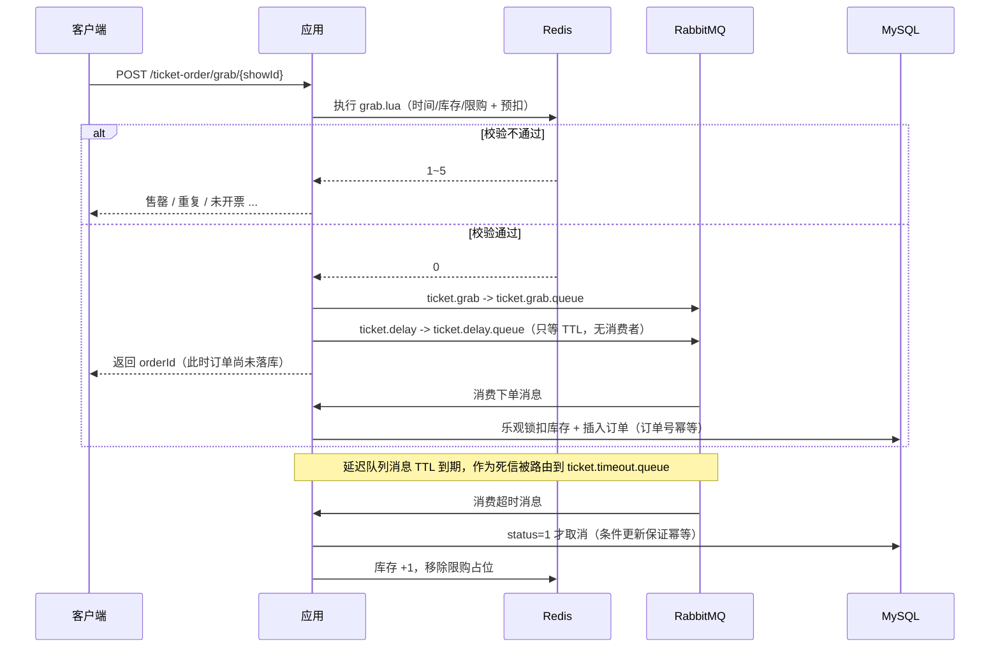

# ShowTicket · 演出抢票平台

一个面向演出票务场景的高并发电商后端：场馆/演出浏览、实名抢票、下单支付、超时自动关单、观演剧评与社交关注。

核心难点集中在**抢票链路**：用 Redis + Lua 做原子预扣与限购，用 RabbitMQ 做异步下单削峰，用「TTL + 死信队列」做超时关单与库存回补。

---

## 技术栈

| 层次 | 技术 |
| --- | --- |
| 语言 / 框架 | Java 21、Spring Boot 2.7、Spring MVC |
| 持久层 | MySQL 8.0、MyBatis-Plus |
| 缓存 | Redis 7（String / Hash / Set / ZSet / GEO / BitMap / HyperLogLog / Lua） |
| 消息队列 | RabbitMQ 3.12（异步下单、TTL+死信延迟关单、消费重试、死信队列） |
| 分布式协调 | Redisson（可重入锁） |
| 其他 | Hutool、Lombok、Docker Compose |

---

## 核心功能

- **登录**：手机号验证码 + Redis Token，双拦截器实现无感续期
- **场馆**：详情缓存（逻辑过期防击穿 + 空值缓存防穿透）、附近场馆 GEO、详情页 UV 统计
- **演出**：按场馆查询在售演出与票档库存
- **抢票**：Lua 原子校验「开售时间 + 库存 + 一人一票」，RabbitMQ 异步落库
- **订单**：支付、订单详情、我的订单、超时未支付自动取消并回补库存
- **剧评**：发布剧评、点赞（ZSet 按时间排序）、点赞用户列表
- **社交**：关注 / 取关、共同关注（Set 交集）、关注流 Feed（推模式 + 滚动分页）
- **签到**：BitMap 按月存签到状态，位运算统计连续签到天数

---

## 抢票链路设计



### 为什么这么设计

**1. 抢票接口不碰数据库**

请求链路只有一次 Lua 脚本执行，把「开售时间、库存、一人一票」三个判断和扣减放在 Redis 内原子完成，避免并发下的超卖与重复下单。开售窗口以 hash 存 epoch 秒，也在脚本里判断，不需要额外查询。

**2. 异步落库削峰**

抢票成功后只发一条 MQ 消息，接口立即返回订单号。数据库写入、行锁竞争全部挪到消费者侧，接口 QPS 由「数据库能承受多少」变成「Redis 能承受多少」。

**3. 消费幂等**

订单号由 Redis 全局唯一 ID（时间戳 + 自增序列）在入口生成并随消息携带。消费者先按订单号查一次，已存在直接返回；扣库存与插入订单在同一个事务里，任一失败都不留脏数据。RabbitMQ 是 at-least-once，重复投递是常态，幂等必须落在业务侧。

**4. 消费重试与死信**

`spring.rabbitmq.listener.simple.retry` 开启本地重试（3 次、指数退避），重试耗尽后 `default-requeue-rejected=false` 让消息进入死信交换机 `ticket.dlx`，最终落到 `ticket.dead.queue`，避免「失败消息无限重回队列打满 CPU」。

**5. 超时关单：TTL + 死信队列**

RabbitMQ 原生不支持任意时长的延迟消息（需要额外插件），这里用经典方案：

1. 下单时把消息投到 `ticket.delay.queue`，这个队列**没有消费者**，只设置了 `x-message-ttl = app.order.timeout-ms`；
2. 消息在队列里存活到期后成为死信，按 `x-dead-letter-exchange / routing-key` 被重新路由到 `ticket.timeout.queue`；
3. 消费者收到后检查订单：已支付什么都不做；未支付则 `status = 1` 条件更新为已取消，**只有更新成功的那次才回补库存**，重复消费或与支付并发都不会多加票。

回补同时作用于三处：MySQL 库存 +1、Redis 库存 +1、移除该用户的限购占位，用户可重新抢票。

**6. 失败补偿**

如果 Redis 预扣成功但消息发送失败（broker 不可用），接口会立即回补 Redis 库存与限购标记，返回「系统繁忙」，避免「扣了票却没有订单」；落库时若 DB 库存不足（说明 Redis 与 DB 不一致），回补 Redis 并记录告警，消息正常 ack，不做无意义重试。

### 为什么是 RabbitMQ

| 方案 | 优点 | 在本项目里的取舍 |
| --- | --- | --- |
| RabbitMQ | 内存占用小、路由灵活、开箱即用 | 采用。延迟消息用 TTL+DLX 实现，逻辑清晰 |
| RocketMQ | 自带延迟级别、事务消息、高吞吐 | broker 默认就要 4G 堆，本地开发太重 |
| Redis Stream | 不引入新中间件 | 重试、死信、堆积监控都要自己实现 |

> RabbitMQ 的队列 TTL 是**队列级**参数：修改 `app.order.timeout-ms` 后需要先删除 `ticket.delay.queue` 再重启，否则新参数不会生效（队列已存在时声明参数不一致会被忽略/报错）。

---

## 缓存与 Redis 数据结构

| 场景 | 方案 |
| --- | --- |
| 场馆详情 | 逻辑过期 + 互斥重建（防击穿），空值缓存（防穿透） |
| 附近场馆 | GEO，按分类建 key，`search` 按距离排序后内存分页 |
| 抢票库存 / 开售时间 / 限购 | String + Hash + Set，Lua 原子操作 |
| 剧评点赞 | ZSet，score 为点赞时间戳，支持「点赞用户按时间排序」 |
| 关注流 | 推模式：发布剧评时写入所有粉丝的 ZSet，`reverseRangeByScore` 滚动分页 |
| 共同关注 | Set 交集 `SINTER` |
| 签到 | BitMap：`SETBIT` 标记、`BITFIELD` 取本月状态、位运算算连续天数 |
| 场馆 UV | HyperLogLog：固定约 12KB 估算去重人数 |

---

## RabbitMQ 拓扑

```
ticket.exchange (direct)
  ├─ ticket.grab    -> ticket.grab.queue      抢票下单（消费）
  ├─ ticket.delay   -> ticket.delay.queue     延迟队列（无消费者，等 TTL）
  └─ ticket.timeout -> ticket.timeout.queue   TTL 到期后由死信路由过来（消费）

ticket.dlx (direct)
  └─ ticket.dead    -> ticket.dead.queue      重试耗尽后的死信
```

---

## 目录结构

```
show-ticket
├── sql/show_ticket.sql         # 建表 + 种子数据
├── docker-compose.yml          # MySQL / Redis / RabbitMQ
└── src/main/java/com/showticket
    ├── config/                 # MVC、MyBatis、Redisson、启动预热
    ├── controller/             # 接口层
    ├── mq/                     # RabbitMQ 拓扑、消息体、生产者、消费者
    ├── service/impl/           # 业务实现
    ├── entity/ mapper/ dto/    # 数据模型
    └── utils/                  # 缓存工具、全局 ID、拦截器
```

---

## 快速开始

### 1. 启动中间件

```bash
docker compose up -d
```

容器起来后：MySQL `127.0.0.1:3306`（root/123456）、Redis `127.0.0.1:6379`（密码 123）、RabbitMQ `127.0.0.1:5672`，管理台 http://localhost:15672 （guest/guest）。

> 不用 Docker 的话：导入 `sql/show_ticket.sql`，启动 Redis 并设密码 123，再本地安装 RabbitMQ（需先装 Erlang）。
> 队列和交换机由应用启动时自动声明，不需要在管理台手动建。

### 2. 确认配置

`src/main/resources/application.yaml`：

- `spring.datasource`：MySQL 地址与密码
- `spring.redis`：Redis 地址与密码
- `spring.rabbitmq`：RabbitMQ 地址、账号
- `app.order.timeout-ms`：订单超时时间，同时是延迟队列 TTL（默认 60000，演示用 1 分钟）
- `app.warmup.enabled`：启动预热开关（默认 true）

### 3. 启动

```bash
mvn spring-boot:run
```

启动日志里应能看到：

```
[预热] 场馆 GEO 写入完成，共 5 个分类
[预热] showId=1 库存=50 开售窗口={begin=..., end=...}
[预热] 完成：场馆 12 个，票档 10 个
```

> 预热会把场馆 GEO、场馆缓存、票档库存与开售窗口写入 Redis。抢票时如果 Redis 里没有数据，也会自动从 DB 懒加载一次。

---

## 接口一览

| 方法 | 路径 | 说明 | 是否登录 |
| --- | --- | --- | --- |
| POST | `/user/code?phone=` | 发送验证码（日志里打印） | 否 |
| POST | `/user/login` | 登录，返回 token | 否 |
| GET | `/venue/{id}` | 场馆详情（走缓存） | 否 |
| GET | `/venue/of/type?typeId=&current=&x=&y=` | 按分类分页，带坐标走 GEO | 否 |
| GET | `/venue/uv/{id}` | 记录访问并返回 UV | 否 |
| GET | `/show-type/list` | 演出分类 | 否 |
| GET | `/show/list/{venueId}` | 场馆在售演出 | 否 |
| POST | `/ticket-order/grab/{showId}` | 抢票，返回订单号 | 是 |
| GET | `/ticket-order/{id}` | 订单详情 | 是 |
| GET | `/ticket-order/of/me` | 我的订单 | 是 |
| POST | `/ticket-order/pay/{id}` | 支付 | 是 |
| GET | `/review/hot?current=1` | 热门剧评 | 否 |
| POST | `/review` | 发布剧评（推送粉丝） | 是 |
| PUT | `/review/like/{id}` | 点赞 / 取消点赞 | 是 |
| GET | `/review/likes/{id}` | 点赞用户列表 | 是 |
| GET | `/review/of/follow` | 关注流（滚动分页） | 是 |
| PUT | `/follow/{id}/{isFollow}` | 关注 / 取关 | 是 |
| GET | `/follow/or/not/{id}` | 共同关注 | 是 |
| POST | `/user/sign` | 签到 | 是 |
| GET | `/user/sign/count` | 连续签到天数 | 是 |

---

## 演示流程

```bash
# 1. 登录（验证码看控制台日志）
curl -X POST "http://localhost:8081/user/code?phone=13800000001"
curl -X POST http://localhost:8081/user/login \
  -H "Content-Type: application/json" \
  -d '{"phone":"13800000001","code":"日志里的6位验证码"}'

# 2. 抢票（TOKEN 换成上一步返回值）
curl -X POST http://localhost:8081/ticket-order/grab/1 -H "authorization: TOKEN"

# 3. 立刻查订单（消费者可能还没落库，稍等再查一次）
curl http://localhost:8081/ticket-order/ORDER_ID -H "authorization: TOKEN"

# 4. 不支付，等 1 分钟，再查订单应变为已取消（status=4）
#    同时 Redis 库存 ticket:stock:1 会 +1，ticket:order:1 中该用户被移除
redis-cli -a 123 get ticket:stock:1

# 5. 再抢一次应该成功（限购占位已释放）
curl -X POST http://localhost:8081/ticket-order/grab/1 -H "authorization: TOKEN"
```

验证重复下单：同一用户第二次抢同一场，Lua 返回 2，接口提示「每人限购一张」。

验证未开票：种子数据里第 9 场开售时间是 3 天后，抢它会提示「还未开票」。

---

## 已验证 / 未验证

**已在本机实测通过（MySQL 8.0 + Redis）：**

- 启动预热：GEO 写入 5 个分类、10 个票档库存与开售窗口
- `/show-type/list`、`/venue/{id}`（逻辑过期缓存）、`/show/list/1` 正常返回
- `/venue/of/type` 带坐标返回按距离排序的场馆（439 m）
- `/venue/uv/1` 同一 IP 重复访问 UV 保持 1（HyperLogLog 去重）
- 验证码登录、token 鉴权正常
- MQ 不可用时抢票返回「系统繁忙」，Redis 库存从 49 回到 50、限购占位清空（失败补偿生效）
- 订单核心逻辑集成测试通过：`TicketOrderFlowTests`（落库扣库存 → 重复消费幂等 → 超时关单回补 → 重复关单幂等）

**待验证：**

- RabbitMQ 真实 broker 下的完整链路（下单消息消费、TTL 到期转死信、重试与死信队列）。本机未安装 RabbitMQ，装好后按上面「演示流程」跑一遍即可。

---

## 压测建议（JMeter）

1. 线程组 500 线程、10 秒内启动、循环 2 次；
2. 前置：为每个线程准备不同用户的 token（可用 CSV）；
3. 压测 `POST /ticket-order/grab/1`（库存 50）；
4. 断言：成功响应数 = 库存数，订单表条数 = 库存数，无负库存。

对比口径：把 `grabTicket` 改回「同步扣库 + 事务落库」的老实现，同一台机器压出 QPS 和 P99，即可得到简历上的对比数据。

---

## 已知不足 / 可继续优化

- 延迟关单依赖队列 TTL，改超时时间需要重建延迟队列；且长 TTL 场景下死信触发依赖队头消息，不适合差异化延迟；
- 未开启 publisher confirm / return，极端情况下消息可能丢；可加本地消息表或事务性 outbox；
- Redis 与 DB 库存回补是两步操作，进程崩溃时可能不一致；
- 未接入 ES 与限流，搜索仍是 `LIKE`，秒杀接口也没有令牌桶；
- 无前端页面，接口用 curl / Postman 演示。
